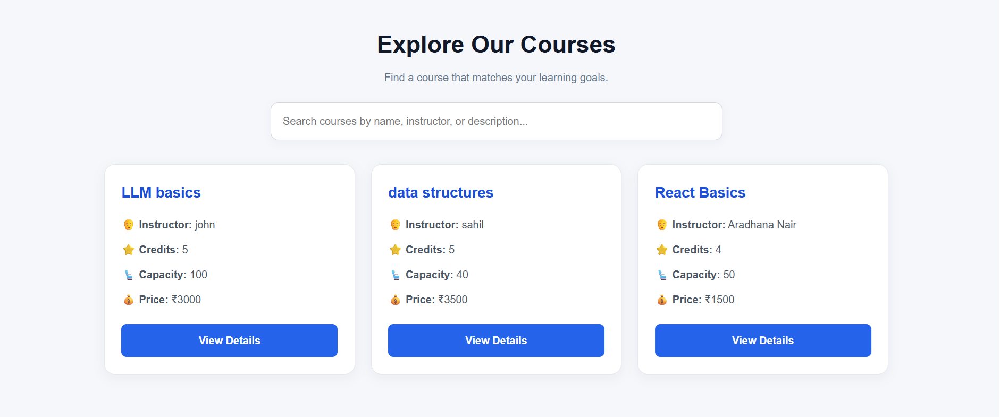
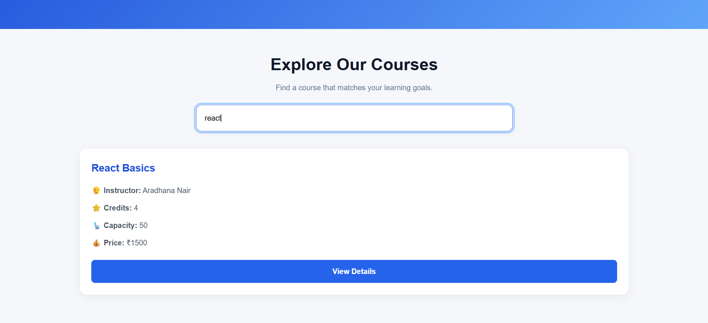
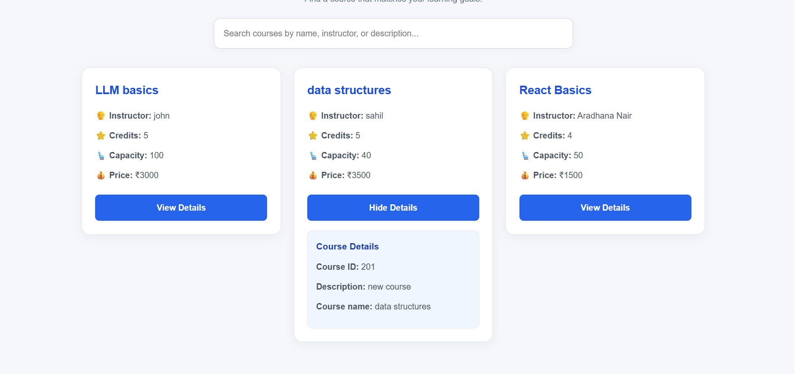

# Course Catalog Management System

A full-stack Course Catalog Management System built with **Python, FastAPI, MySQL, and React**.

## Overview

This project provides a platform for managing courses in an e-learning environment. It integrates a FastAPI backend with a MySQL database and a React frontend.

## Tech Stack

- **Backend:** Python, FastAPI
- **Database:** MySQL
- **ORM:** SQLAlchemy
- **Frontend:** React, JavaScript, Vite
- **Tools:** Git, GitHub, VS Code

## Features

- Course management with CRUD operations
- REST API development using FastAPI
- Database integration using SQLAlchemy and MySQL
- React-based user interface
- Course listing and course creation interface

## Project Structure

```text
course_catalog/
├── controllers/
├── frontend/
├── database.py
├── main.py
├── models.py
├── requirements.txt
├── schema.py
└── README.md
```

## Getting Started

### 1. Clone the repository

```bash
git clone https://github.com/arpitaswain07/course-catalog-management-system.git
cd course-catalog-management-system
```

### 2. Install backend dependencies

```bash
python -m venv .venv
```

Activate the virtual environment on Windows:

```powershell
.venv\Scripts\Activate.ps1
```

Install dependencies:

```bash
pip install -r requirements.txt
```

### 3. Configure the database

Create a MySQL database and configure the database connection using your local environment settings.

### 4. Run the backend

```bash
uvicorn main:app --reload
```

Open `http://127.0.0.1:8000/docs` to explore the API through Swagger UI.

### 5. Run the frontend

```bash
cd frontend
npm install
npm run dev
```

## Project Status

This project is under development. Features and documentation may evolve as development continues.

## 📸 Screenshots

### 1. Home Page


### 2. Course Listing


### 3. Search Functionality


### 4. Course Details


## Author

**Arpita Swain**

GitHub: [arpitaswain07](https://github.com/arpitaswain07)
